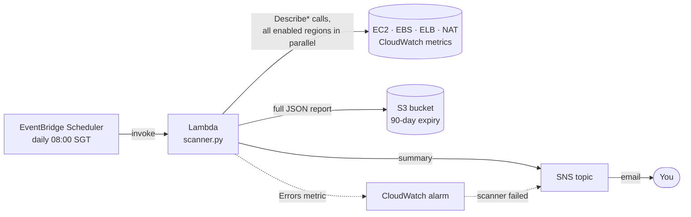

# AWS Cost & Unused Resource Scanner


A serverless job that scans every enabled AWS region once a day for resources that cost money but do nothing, estimates the monthly waste, and emails a report. An optional delete mode removes what it finds, after a 7-day grace period.

**Stack:** Python 3.12 · AWS Lambda · EventBridge Scheduler · SNS · S3 · CloudWatch · IAM · Terraform · pytest + moto · GitHub Actions

## What it detects

| Resource | Rule | Delete mode |
|---|---|---|
| EBS volumes | Not attached to any instance | Deleted |
| Elastic IPs | Not associated with anything | Released |
| EBS snapshots | Owned by you, older than 30 days | Deleted (skipped if an AMI uses it) |
| Stopped EC2 instances | Stopped; reports the cost of their attached volumes | **Report only, never terminated** |
| Load balancers (ALB/NLB/GWLB) | No registered targets in any target group | Deleted |
| Classic load balancers | No registered instances | Deleted |
| NAT gateways | Zero bytes sent in the last 7 days (CloudWatch) | Deleted |

Tag any resource `cost-scanner:ignore=true` to have it skipped.

## Architecture



## Example output

Email summary ([full sample](docs/sample-email.txt)):

```
ESTIMATED MONTHLY WASTE: $34.53
Scanned 3 regions in 2.7s · Mode: DRY RUN (nothing deleted)

── Unattached EBS volumes (1) ── $10.00/mo
  ap-southeast-1  vol-40842664553c82975  size_gib=100 volume_type=gp2  $10.00  [none (dry run)]

── Unassociated Elastic IPs (2) ── $7.30/mo
  ...
```

The full JSON report is saved to S3 ([sample](docs/sample-report.json)). Both samples were generated by running the scanner against moto.

### Screenshots

<!-- Replace these with your own screenshots after deploying -->
| | |
|---|---|
|  |  |
| *Daily email report* | *JSON reports in S3* |
|  |  |
| *CloudWatch logs* | *`terraform apply` output* |

## Setup

**You need:** an AWS account, the [AWS CLI](https://aws.amazon.com/cli/) configured (`aws configure`), [Terraform](https://developer.hashicorp.com/terraform/install) ≥ 1.5 and Python 3.12+.

```bash
# 1. Run the tests locally (no AWS account needed)
python -m venv .venv
.venv\Scripts\activate          # macOS/Linux: source .venv/bin/activate
pip install -r requirements-dev.txt
pytest

# 2. Deploy
cd terraform
terraform init
terraform apply -var="email=you@example.com"
```

AWS sends a **"Subscription Confirmation"** email. Click the link, or no reports will arrive.

```bash
# 3. Create demo waste, then run the scan now instead of waiting for 08:00
cd ..
python scripts/create_waste.py
aws lambda invoke --function-name cost-scanner --region ap-southeast-1 out.json
```

The email arrives within a minute.

### Delete mode (optional)

```bash
terraform apply -var="email=you@example.com" -var="enable_delete=true"
```

This sets `DRY_RUN=false` **and** attaches the delete IAM policy. Deleting then follows a mark-then-sweep pattern:

1. First run where a resource is flagged: it gets tagged `cost-scanner:first-flagged=<date>`. Nothing is deleted.
2. Runs within the next 7 days: reported as `pending`.
3. First run after 7 days, if it's still idle: deleted.

Even with delete mode on, IAM only allows deleting resources that carry that tag.

## Tear down

```bash
python scripts/cleanup_waste.py     # demo resources aren't managed by Terraform
cd terraform
terraform destroy -var="email=you@example.com"
```

`destroy` removes everything, including the S3 bucket with its reports (`force_destroy`) and the Lambda's log group, which Terraform creates itself so it doesn't get left behind.

## Cost

| Item | Cost |
|---|---|
| Lambda (1 run/day, a few seconds) | Free tier |
| EventBridge Scheduler (30 runs/month) | Free tier (14M/month) |
| SNS email (30/month) | Free tier (1,000/month) |
| S3 (small JSON files, 90-day expiry) | < $0.01/month |
| CloudWatch alarm + logs (14-day retention) | Free tier |
| Describe API calls | Free |
| **Demo waste** (1 GiB volume + 1 Elastic IP) | **~$0.005/hour.** Run `cleanup_waste.py` when done |

Set an [AWS Budget](https://console.aws.amazon.com/billing/home#/budgets) alert at $5 as a safety net.

**About the estimates:** prices are hardcoded in `scanner.py` using approximate us-east-1 on-demand rates. Singapore is about 10–30% higher. Snapshot costs are overestimated because snapshots are incremental. The report is for spotting waste, not for reconciling your bill.

## Design decisions

- **Dry run by default, with one switch.** `enable_delete` controls both the `DRY_RUN` variable and whether the delete IAM policy exists, so they can't disagree. In dry-run mode the role has no delete permissions at all.
- **Defence in depth on deletes.** The code waits out a grace period, and IAM only allows deleting resources the scanner already tagged.
- **Stopped instances are report-only.** Terminating is irreversible, and a stopped instance is often paused on purpose.
- **Failures stay inside one check.** If one check fails in one region (e.g. AccessDenied), it's listed under `errors` and the rest of the scan continues.
- **No dependencies in the Lambda.** boto3 ships with the runtime, so there's no layer and no packaging step.
- **Skipped security checks are documented.** checkov runs in CI, and every skipped check has its reason in [.checkov.yaml](.checkov.yaml). Most would cost money (KMS keys, putting the Lambda in a VPC) without protecting anything here.

## Project structure

```
src/scanner.py          Lambda: detectors, pricing, grace-period delete, report
tests/test_scanner.py   10 tests against moto (fake AWS)
terraform/              Lambda, IAM, S3, SNS, Scheduler, alarm
scripts/                create_waste.py / cleanup_waste.py for demos
docs/                   sample report and email
.github/workflows/      CI: pytest, terraform fmt/validate, checkov
```

## Future work

- Live prices from the AWS Pricing API instead of the hardcoded table
- More checks: idle RDS, old AMIs, log groups without retention, unused Secrets Manager secrets, idle VPC endpoints
- "New since yesterday" section by comparing against the previous report
- Multi-account scanning across an AWS Organization via assumed roles

## What I learned

<!-- Rewrite this in your own words after you've deployed it. Interviewers ask about specifics. -->

- **"Unused" is a judgement call.** Yes/no states (attached or not) are reliable. Idle checks need metrics and a threshold, and they can be wrong. That's why deleting is opt-in and waits out a grace period.
- **Least privilege in practice.** AWS doesn't let you narrow Describe calls to specific resources, so the read policy needs `"*"`. Tag-based conditions (`aws:ResourceTag`) let me restrict deletes to resources the scanner already flagged.
- **Free tier traps.** Every public IPv4 address now costs money, an idle NAT gateway is about $45/month, and putting the Lambda in a VPC would have needed one. Reserving Lambda concurrency fails on new accounts, whose limit is only 10.
- **Clean teardown takes planning.** Lambda creates its own log group unless Terraform creates it first, and S3 buckets with objects in them block `destroy` unless `force_destroy` is set.
- **Testing AWS code without AWS.** moto fakes AWS APIs in memory. It doesn't behave exactly like AWS: it raises `TargetGroupNotFound` where real AWS returns an empty list, and it ships its own AMI snapshots. Passing `now` into functions let me test the 30-day and 7-day rules without waiting or mocking the clock.
- **boto3 and threads.** Sessions aren't thread-safe, so each region's thread creates its own.
